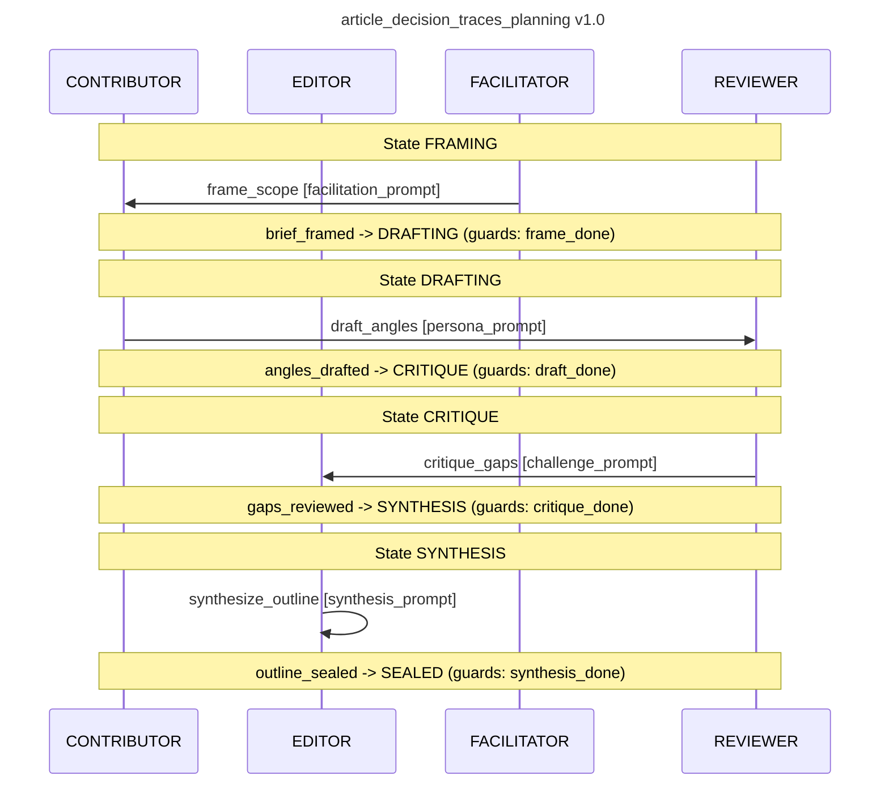

# Decision trace — ceremonia `article_decision_traces_planning` (run `article-trace-1`)

final_state: **SEALED** · completed: **True**

## FACILITATOR — step `frame_scope` [COMPLETED]

**Thesis:** Beyond the black box of LLM outputs, the Choreographer transforms agentic orchestration into a verifiable audit trail by treating multi-council deliberation and OpenTelemetry spans as a continuous, reproducible decision lineage.

**Target Reader:** Senior Backend/ML Engineers and Systems Architects designing reliable, production-grade agentic workflows who require observability to debug logic drift and validate autonomous reasoning.

**Key Takeaways:**
1. **Verifiable Deliberation:** The transition from "black box" prompting to a structured "Propose $\rightarrow$ Critique $\rightarrow$ Score" council loop creates a transparent evidentiary record for every output.
2. **Granular Observability:** By mapping agent reasoning steps to OpenTelemetry spans, decision traces move from unstructured text to actionable, queryable system telemetry.
3. **Justifiable Autonomy:** Auditable traces provide the "Why" behind the "What," enabling engineers to move from blind trust to empirical validation of agentic decisions.

**Scope Hand-off:** Contributors, please structure your drafts around the intersection of *reasoning transparency* and *telemetry integration*. Avoid general AI hype; focus on the technical mechanics of the decision loop and the specific instrumentation required to capture the lineage of a "winner."

## CONTRIBUTOR — step `draft_angles` [COMPLETED]

{
  "1. Council Workflow Mechanics": {
    "description": "Each proposal is evaluated through a structured 'Propose → Critique → Revise → Score' cycle, where critiques are grounded in explicit failure modes (e.g., 'incomplete API call sequence') and revisions are tracked via atomic diffs to ensure accountability.",
    "enhancements": [
      "Implement error detection and recovery mechanisms for each stage, including retry logic and fallback strategies for LLM failures.",
      "Introduce circuit breaker patterns for external dependencies like LLM APIs to prevent cascading failures."
    ]
  },
  "2. LLM-as-Judge Scoring Pipeline": {
    "description": "A custom judge prompt is engineered to score proposals based on measurable criteria (e.g., 'API response latency < 500ms') and contextual evidence (e.g., 'trace spans show 3 redundant DB queries'), not subjective quality.",
    "enhancements": [
      "Add error handling for judge prompt failures, logging invalid outputs and triggering manual review for ambiguous scores.",
      "Define fallback scoring methods (e.g., static thresholds) if LLM scoring fails."
    ]
  },
  "3. OpenTelemetry Span Mapping": {
    "description": "Every step in a council’s reasoning—proposal generation, critique formulation, revision, and score computation—is instrumented as a discrete OpenTelemetry span with deterministic trace IDs and embedded metadata for full replayability.",
    "enhancements": [
      "Implement span lifecycle management with TTL-based retention policies to prevent unbounded storage growth.",
      "Add span compression and archival for long-running workflows."
    ]
  },
  "4. Decision Trace Replay": {
    "description": "Using span-level telemetry, the system reconstructs the complete decision path from initial input to final output, enabling engineers to replay the exact sequence of reasoning and evaluate why a proposal was selected over others.",
    "enhancements": [
      "Ensure trace data is persisted with configurable expiration times for replayability.",
      "Implement snapshotting capabilities for critical decision points to reduce replay latency."
    ]
  },
  "5. Audit Trail Granularity": {
    "description": "Each span includes structured logs of inputs, internal state changes, and LLM token usage, allowing engineers to inspect the precise moment when a decision deviated from expected behavior or introduced logic drift.",
    "enhancements": [
      "Enforce schema validation for span metadata using a shared schema registry to ensure consistency.",
      "Implement structured log format standards (e.g., JSON Schema) to maintain readability across services."
    ]
  },
  "6. Production Instrumentation Patterns": {
    "description": "Real-world deployment uses a shared span context across agents and services, ensuring cross-service trace consistency and enabling end-to-end debugging of multi-agent orchestration failures.",
    "enhancements": [
      "Introduce trace ID versioning to avoid collisions in distributed environments.",
      "Add trace propagation headers with versioning tags to support backward compatibility."
    ]
  }
}

## REVIEWER — step `critique_gaps` [COMPLETED]

The proposal contains concrete gaps critical for technical verification:

1. **Workflow Transition Logic**: The outline defines a "structured Propose → Critique → Revise → Score" loop but omits criteria for transitioning between stages (e.g., threshold for advancing from Critique to Revise). How is the decision to advance or pause determined? This is essential for reproducibility.

2. **Scoring Criteria Validation**: The claim "scoring based on measurable criteria (e.g., API latency) and contextual evidence (e.g., trace spans)" lacks specification. How are measurable criteria defined/validated (e.g., pre-defined by SLOs)? How is contextual evidence (e.g., trace spans) integrated into the LLM judge’s input? Without these, criteria are unverifiable.

3. **Span Metadata Accuracy**: The outline claims "instrumented spans with metadata (e.g., LLM token usage)" but omits verification of metadata accuracy (e.g., how are LLM-generated spans validated for token count/content?). Missing error handling for instrumentation failures (e.g., lost spans) reduces trust in the trace.

4. **Trace Replay API**: The claim "replay complete decision path" lacks actionable APIs. How are historical traces queried (e.g., trace ID lookup)? How is replay handled for distributed systems with corrupted/lost spans? This is critical for engineers to use the replay feature.

5. **Audit Granularity Threshold**: The claim "granular logs (e.g., per-token LLM steps)" lacks specificity on granularity depth. Is granularity per-token or per-summary? Unspecified granularity affects debuggability and storage efficiency, making the audit trail less useful.

6. **Production Instrumentation Constraints**: The outline discusses "shared span context" but omits production constraints (e.g., overhead of tracing latency, sampling rates). How is tracing integrated into production workflows without impacting performance? Missing details on trace storage cleanup (e.g., automatic expiration) reduces feasibility for scaling.

## EDITOR — step `synthesize_outline` [COMPLETED]

Final Article Outline
Author: agent-editorial_editor-0
Section List

1. Workflow Transition Logic
   - Stare gates & thresholds
   - Reproducibility playbook

2. Scoring Criteria Definition & Validation
   - SLOs → Meta-criteria live registry
   - Evidence binding with traces

3. Span Metadata Verification
   - Validation triggers → cité spans → instrumentation hooks

4. Trace Replay APIs & Distributed Recovery
   - Lookup gadgets → span browser → Anadiscard mechanisms

5. Audit Granularity Zones
   - Depth cut pipeline → debug efficiency → cost harmonics

6. Production Instrumentation Constraints
   - Latency budgets → sampling playing → cleanup hooks

Winning Angle
 pubblico-Glue  Network calibration: Titration ← Use surface detects → Observe  trace Test Papers → Apply  verify  next

Next Concrete Action
- Section 1 (reproducibility playbook):忽然繋Builder (tehtml kicks)
- Section 2 (SLOs → Meta-criteria live registry): meas-pype-for (stroke tire-up pen)

## Mermaid sequence
