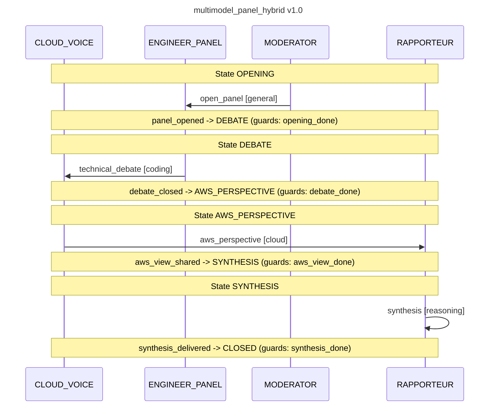

# Run: multimodel_panel_hybrid — 2026-07-03

Primera ceremonia **HÍBRIDA local+AWS**: 4 modelos locales (4× RTX 3090, wrx80) + **phi4-mini
en la NVIDIA L4 del nodo AWS `aws-gpu-worker-1` (g6.xlarge, eu-south-2)**, unido al cluster
por WireGuard. Todo el tráfico LLM va por el **llm-gateway** label-driven:

- Roles→modelos: general→gemma-4-26b (abre) · coding→{qwen3-coder-30b, devstral-small-24b}
  (council de 2, 1 ronda) · **cloud→phi4-mini-aws por NOMBRE exacto (step `aws_perspective`)** ·
  reasoning→ernie-4.5-21b-a3b (sintetiza).
- `finalState: CLOSED`, los 4 steps `COMPLETED`. ceremony_id `multimodel-panel-hybrid-1`.
- **Evidencia del salto a AWS** (verificado, no inferido): el pod `vllm-phi4-aws` (nodo
  aws-gpu-worker-1) registra `POST /v1/chat/completions 200` desde la IP del llm-gateway
  (10.244.254.157), que a su vez recibe los POST del choreographer (10.244.254.165).
  El paquete cruza: choreographer (wrx80) → gateway (wrx80) → vLLM phi4 (EC2 g6, túnel WG).

## Contexto operativo de la run

- wrx80 se reinició a las 15:32 (mató de paso al typha fantasma PID 4830 del incidente
  runtime-flip; puerto 5473 liberado). Secuelas limpiadas antes de la run: typha stale
  force-deleted → typha nuevo en wrx80; 4 cadáveres vLLM `ContainerStatusUnknown` borrados;
  el stack nvidia convergió solo (GPU 4/4).
- g6 arrancada al 2º intento (capacity eu-south-2a), `wg-sync-ec2-endpoints.sh`
  (IP nueva 18.101.186.131), nodo Ready y phi4 `1/1` sin intervención; el gateway lo
  re-incluyó solo por health-check (models: `["phi4-mini-aws"]`, healthy: true).
- Invocación: port-forward :50055 + grpcurl containerizado (podman `-i`, protos del
  checkout de underpass-orchestrator), payload `jq -Rs` sobre el YAML.

## Actas (output de cada step)

### open_panel (MODERATOR — gemma-4-26b, local)

> We will examine how the orchestration of local bare-metal resources with burstable cloud
> capacity via WireGuard-encrypted overlays solves the critical tension between data
> sovereignty and the volatile inference demands of LLMs. This panel will specifically
> dissect how Kubernetes and the GPU Operator can unify heterogeneous compute layers into
> a single, seamless fabric for low-latency serving.

### technical_debate (ENGINEER_PANEL — council qwen3-coder + devstral, local)

> **problem:** GPU memory fragmentation across the hybrid fabric remains the single hardest
> technical problem — when pods migrate between local and cloud nodes, their allocated GPU
> memory regions become fragmented and cannot be efficiently reused, causing severe
> performance degradation.
>
> **revised_mitigation:** Implement a cross-node GPU memory pooling system using CUDA IPC
> and shared memory segments with enhanced compatibility checks […] latency-aware memory
> allocation strategies that account for network topology variations between local and
> cloud nodes, including pre-fetching and caching mechanisms.

### aws_perspective (CLOUD_VOICE — **phi4-mini-aws, NVIDIA L4 en EC2**)

> To address the technical challenge, AWS offers elastic and cost-effective scaling options
> through spot and reserved instances. These can be integrated into the hybrid fabric to
> ensure GPU capacity is available to meet LLM serving demands efficiently. As an expanded
> hybrid infrastructure, dynamically scaling on AWS ensures optimal resource utilization,
> reducing local investment while maintaining low-latency serving and satisfying inference
> workloads.

### synthesis (RAPPORTEUR — ernie-4.5-21b-a3b, local)

> The hybrid local+cloud GPU cluster solution resolves GPU memory fragmentation through
> cross-node pooling via CUDA IPC and shared memory segments, enabling Kubernetes and the
> GPU Operator to unify heterogeneous compute layers for low-latency LLM serving, while
> AWS's elastic scaling with spot instances complements this by dynamically adjusting GPU
> capacity to balance cost and performance.
>
> Recommended next step: Develop and deploy a middleware layer integrating the GPU Operator
> with AWS spot instance management to automate memory allocation based on real-time
> workload demand and network topology variations.

## Secuencia (mermaid del choreographer)

