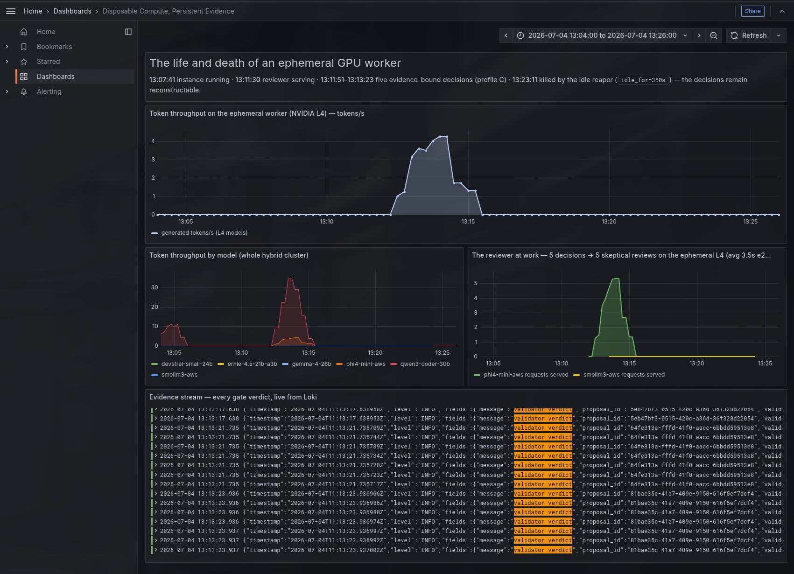

# Dejé que mis workers GPU se apagaran a los 5 minutos. Sus decisiones tenían que seguir siendo auditables.

> **BORRADOR v8 (castellano)** — 2026-07-05. Regla cumplida: nada inventado.
> El experimento está EJECUTADO y todos los datos son reales (fuentes en
> `experiment/RESULTS.md`; cada cifra tiene artifact, trace_id o log).
> Hook A elegido y fusionado con el §1; hook B descartado. Capturas
> principales integradas (PNG + GIF). Pendiente: capturas opcionales
> (comandos en el apéndice), flip del repo a público y pasada editorial
> humana. Traducción al inglés cuando el texto esté cerrado.

---

El peor fallo de mi cluster de agentes no fue que un modelo alucinara. Fue
que el verificador convirtió esa alucinación en un hecho.

El contexto era simple: quería probar un cluster GPU híbrido. La parte estable
estaba en mi máquina local, con 4 GPUs NVIDIA Ampere de 24 GB. La parte
desechable estaba en AWS: un worker GPU que arrancaba bajo demanda, se unía al
cluster por WireGuard y se apagaba solo si pasaba cinco minutos sin trabajo.

Para probarlo necesitaba algo más real que un "hello world". Elegí una
investigación forense tipo [*whodunit*](https://en.wikipedia.org/wiki/Whodunit):
un equipo de seis modelos de IA investigando un incidente
real del propio cluster. Un proceso se había quedado huérfano, retenía un
puerto, y ni Kubernetes ni el runtime podían matarlo. Le di al equipo la
evidencia cruda del [journal](https://www.freedesktop.org/software/systemd/man/latest/systemd-journald.service.html)
— sin la conclusión — y roles como: un forense, un
escéptico, un perito, un testigo junior cuyo único trabajo era separar hechos
de conjeturas, y un juez.

Como prueba de infraestructura, la reunión cumplió: los seis pasos de la
ceremonia — así llama el orquestador, el
[Underpass Choreographer](https://github.com/underpass-ai/underpass-choreographer),
a una reunión de agentes con pasos y reglas — cerraron sin errores. Nada de
lo que sigue lo vi en directo: lo descubrí más tarde, leyendo las actas y las
trazas que la observabilidad del Choreographer deja tras cada deliberación.

El forense (un modelo de 30B parámetros) afirmó que el pod tenía
`privileged: true` "según el spec". El material que le di al equipo no decía
eso en ninguna parte. Se lo inventó.

El testigo junior — el modelo más pequeño del equipo, 3B, cuya única función
era verificar los hechos — lo escribió en su registro como **"Fact"**.

Y el juez dictó veredicto con confianza **"High"**, citando esa evidencia.

Cuando monté la apelación — dos consejos de modelos, tres rondas de crítica
adversarial cruzada, incluso con la respuesta correcta del incidente ya
revelada — fue peor: cada ronda de "critica la propuesta de tu compañero"
funcionó como "elabora más". Al final de la tercera ronda, los consejos
proponían "capas de normalización semántica con
[PCA](https://en.wikipedia.org/wiki/Principal_component_analysis)/[UMAP](https://en.wikipedia.org/wiki/Uniform_manifold_approximation_and_projection)"
y "umbrales para ruido por debajo de 20Hz" — propuestas que ya no tenían nada
que ver con el incidente. Nadie volvió a mirar la evidencia.

El problema no era cuántas voces tenía mi reunión de agentes. El problema era
que ninguna afirmación estaba obligada a apoyarse en evidencia — y todo el
aparato social del equipo (crítica, revisión, verificación, juez) amplificaba
la fluidez, no la verdad.

Así que cambié la pregunta.

Si los agentes van a participar en decisiones reales, no basta con guardar la
respuesta final: hay que poder reconstruir cómo se llegó a ella.

---

## 1. La primera pregunta equivocada

Mi primera pregunta había sido "¿cuántos agentes necesito para que esto
delibere bien?". Era la pregunta equivocada, y las actas lo demuestran con
datos reales, reproducibles desde
[mi repo](https://github.com/underpass-ai/aws-side-cluster):

- El equipo de 6 modelos — dos de ellos, por cierto, sirviendo desde un nodo
  g6.xlarge de AWS conectado de forma segura a mi cluster local — acertó la
  *clase* de causa raíz del incidente, pero inventó por el camino la
  evidencia clave, y el mecanismo de verificación la dio por buena en vez de
  filtrarla.
- Tres rondas de deliberación tipo
  [*peer review*](https://en.wikipedia.org/wiki/Peer_review) adversarial que,
  con cada iteración, empeoraron las conclusiones frente a la realidad de los
  hechos (12 críticas+revisiones, 31 llamadas LLM, trace `a5ed9c25…`).
- El consenso no es evidencia. Una votación entre modelos sigue siendo solo
  una votación.

Resulta que, tirando del hilo, la literatura reciente describe exactamente
lo que se observaba en las deliberaciones de mi equipo de agentes:

| Lo que describe la literatura | Lo que pasó en mi equipo |
|---|---|
| **La alucinación hace bola de nieve**: un error temprano al que el modelo se sobre-compromete engendra errores derivados ([Zhang et al., ICML 2024](https://arxiv.org/abs/2305.13534)) | El `privileged: true` del forense, convertido en cimiento del veredicto |
| **El verificador sicofante**: los modelos afinados con feedback humano prefieren confirmar lo ya dicho antes que corregirlo ([Sharma et al., ICLR 2024](https://arxiv.org/abs/2310.13548)) | El junior registró como "Fact" la invención de la autoridad |
| **Revisar sin señal externa no corrige** — puede incluso degradar el resultado ([Huang et al., ICLR 2024](https://arxiv.org/abs/2310.01798)) | Tres rondas de apelación que empeoraron las conclusiones, con actas |
| **Los sistemas multiagente fallan por verificación, no por falta de voces**: una de las tres categorías de la taxonomía MAST ([Cemri et al., 2025](https://arxiv.org/abs/2503.13657)) | La categoría exacta de mi equipo: verificación de la tarea |

Después de leerlos, la solución no podía ser más rondas ni mejores prompts:
tenía que ser estructural.

La conclusión operativa no fue "necesito mejores modelos". Fue:

**El problema no es que los agentes alucinen. El problema es dejar que las
afirmaciones sin soporte se conviertan en decisiones.**

## 2. La pregunta correcta

> ¿Puede un cluster con workers efímeros ejecutar una decisión de agentes y
> conservar suficiente evidencia — trazas, logs, métricas — para
> **reconstruir la decisión después de que esos workers se hayan apagado**?

Dos principios, repetidos a lo largo de todo el diseño:

**El cómputo es desechable. La evidencia es persistente.**

**El juez no es otro modelo. El juez es un conjunto de reglas.**

## 3. La arquitectura

La arquitectura tiene tres piezas. Una parte estable coordina. Una parte
desechable aporta GPU cuando hace falta. Y la evidencia vive aparte, en
sistemas que no desaparecen cuando el worker se apaga.

```text
┌─────────────────────────────────────────────────┐
│         Control plane local (estable)           │
│      nodo 4× GPU NVIDIA Ampere 24 GB            │
│  Underpass Choreographer (plano de coordinación)│
│  llm-gateway (routing por labels k8s)           │
│  Prometheus · Tempo · Loki  ← capa de evidencia │
└────────────────────┬────────────────────────────┘
                     │ WireGuard (estrella)
                     ▼
┌─────────────────────────────────────────────────┐
│         Worker GPU efímero (AWS g6, L4)         │
│  arranca → join → sirve modelos → idle →        │
│  APAGADO AUTOMÁTICO a los 5 min sin peticiones  │
└────────────────────┬────────────────────────────┘
                     │ la telemetría sobrevive al worker
                     ▼
┌─────────────────────────────────────────────────┐
│         Capa de evidencia persistente           │
│  trazas (Tempo) · métricas (Prometheus)         │
│  logs (Loki) · decision artifact (JSON, S3)     │
└─────────────────────────────────────────────────┘
```

Lo más importante:

- **El worker se apaga por inactividad real, no por horario**: un *reaper* —
  un proceso de apagado automático — mira en Prometheus la métrica
  `vllm:num_requests_running` de los vLLM alojados en la nube. Si pasan cinco
  minutos sin peticiones, apaga la instancia.

- **La observabilidad es captada por Choreographer**: la
  capa de evidencia existe porque el
  [Underpass Choreographer](https://github.com/underpass-ai/underpass-choreographer)
  instrumenta cada ceremonia — un trace por decisión, un span por
  paso, eventos estructurados con `ceremony_id`, métricas. Prometheus, Tempo
  y Loki guardan esa evidencia fuera del worker.
- **La IP pública del worker cambia en cada arranque**; el control plane de
  Kubernetes la resincroniza. Los pesos de los modelos viven en S3 Glacier
  Instant Retrieval, para poder arrancar el worker desde cero.



*Dashboard de Grafana del worker efímero: la L4 sirve las cinco decisiones
del perfil C (§5), el revisor trabaja en cada una, Loki conserva los
veredictos del juez de reglas y el worker se apaga a las 13:23:11; el último
veredicto había caído a las 13:13:23.*

## 4. La regla del experimento: nada entra sin evidencia

En los artefactos, esta configuración se llama `evidence_bound_review`. En
lenguaje normal: los modelos podían proponer y discutir, pero la decisión final
solo salía si cada afirmación apuntaba a una pieza concreta del paquete de
evidencia (*evidence pack*). Los nombres del diagrama son los del YAML; el
flujo es lo importante:

```text
evidence_collector
  prepara el evidence pack
        │
        ▼
primary_engineer ── propuesta + evidence_refs ──► skeptical_reviewer (L4)
        ▲                                           │
        └──────────── objeciones / revisión ────────┘
                            │
                            ▼
                    deterministic_judge
              ¿cada evidence_ref existe en el pack?
                    sí → entra en el expediente
                    no → rechazo / más evidencia
```

El **juez de reglas** no es un modelo: aplica siempre el mismo contrato de
salida.

Para este punto,
[Underpass Choreographer](https://github.com/underpass-ai/underpass-choreographer)
ya disponía de contratos de salida y rechazo deterministas
(`NoValidProposal`), configurables desde el YAML de la ceremonia.

## 5. Los tres perfiles comparados

La comparación es de **gobernanza**, no de modelos: cambia la regla para
aceptar una salida.

| Perfil | Modelos | Evidencia obligatoria | Juez determinista |
|---|---|---|---|
| A `single_model_freeform` | 1 | no | no |
| B `single_model_evidence_gate` | 1 | sí | sí |
| C `evidence_bound_review` | 2 (uno en el worker efímero) | sí | sí |

Cinco tareas de revisión reales (decisiones de diseño del propio
Choreographer), tres perfiles, **15 ejecuciones canónicas** — una por celda
tarea×perfil. El experimento completo dejó 25 ejecuciones registradas: las 15
canónicas de la tabla, 8 fallos de ceremonia (4 rechazados por el
juez de reglas y 4 por problemas operativos alrededor del *runner*, el script
que lanzaba las ceremonias) y 2 repeticiones duplicadas.
Todo conservado en `experiment/runs/`.

La métrica principal, `unsupported_claim_escape_count`, responde a una pregunta
concreta: ¿cuántas afirmaciones llegaron a la decisión final sin una referencia
existente en el expediente?

Precisión importante: en estas runs, "referencia existente" no significa
"afirmación demostrada". El juez de reglas comprueba que la cita exista en el
paquete; no evalúa si esa cita sostiene la frase. Esa segunda capa ya está en
construcción en Choreographer, pero no formaba parte del experimento medido aquí.

## 6. Qué medí

Esta es la foto del experimento controlado que lancé el 4 de julio de 2026,
después del fallo inicial. No son notas tomadas a mano: cada fila se puede
reconstruir desde artefactos persistidos con su `trace_id`.

| Perfil | Afirmaciones totales | Con ref existente | **Escaped** (se colaron) | Traza sobrevive al apagado | Decisiones |
|---|---|---|---|---|---|
| A freeform | 14 | 0 | **14** | sí | 4 accept · 1 reject |
| B evidence gate | 18 | 18 | **0** | sí | 4 accept · 1 reject |
| C evidence-bound review | 18 | 18 | **0** | sí | 3 accept · **2 reject** |

El perfil A, sin contrato, hizo exactamente lo que me temía: **sus 14
afirmaciones llegaron a la decisión sin una sola referencia a evidencia**. En
los perfiles con contrato, ninguna de las 36 afirmaciones llegó sin una
referencia existente en el expediente. Eso no las convierte automáticamente en
verdaderas; solo elimina la frase que ni siquiera señala de dónde sale.

El contraste más útil apareció en la tarea 1. Con la misma pregunta y el mismo
paquete de evidencia, B cerró en `accept` y C cerró en `reject`. En C, además,
se ve el camino: la propuesta inicial tenía dos afirmaciones, el revisor en la
L4 marcó una objeción `BLOCKING`, y la versión final salió con una sola
afirmación. La traza permite comprobar esos tres pasos después, aunque el
worker que ejecutó al revisor ya esté apagado.

La infraestructura dejó estos tiempos:

- Arranque en frío: **77 segundos** hasta tener la instancia encendida;
  **306 segundos** hasta que el revisor podía servir inferencia. Es decir,
  unos cinco minutos antes de que la L4 estuviera realmente útil; ahí entran
  la unión al cluster, el contenedor/vLLM y la carga de pesos.
- Una vez caliente, no volví a pagar ese arranque mientras el worker siguió
  vivo: las 5 decisiones del perfil C (3 pasos cada una) entraron en **92
  segundos** de deliberación (104 contando la contabilidad del runner entre
  decisión y decisión; fuentes en `experiment/RESULTS.md`). No medí latencia
  por petición; medí la diferencia operativa entre mantener el worker caliente
  unos minutos y dejar que se apague.
- **Apagado autónomo**: el reaper apagó el worker a las 13:23:11 tras 350s de
  inactividad medida (la primera línea real de su `events.log`:
  `idle_shutdown instances=i-084f… idle_for=350s`).
- Vida total del worker: **15,5 GPU-minutos** — unos 0,22 $ a precio
  on-demand de g6.xlarge en eu-south-2 (0,848 $/hora según la Price List de
  AWS a fecha de escritura, julio 2026; EBS y transferencia aparte).

El worker no conservó nada. Lo que sobrevivió quedó fuera: **~32 KB** entre
artefactos de decisión y respuestas del perfil C, más trazas y logs en la capa
de observabilidad. Fue suficiente para reconstruir qué había pasado sin volver
a encender la instancia.

## 7. Reconstruir una decisión con el worker apagado

Escribí una herramienta de terminal en Rust — `decision-trace-tui` — cuyo
punto de entrada no es el cluster: es el **artefacto de decisión**, un JSON
persistido con el `trace_id`, el perfil, las afirmaciones y el ciclo de vida
del worker. Con ese identificador va a Tempo por los spans, a Loki por los
eventos de la deliberación y al estado del worker para comprobar si la máquina
sigue viva.

Este es el caso que me interesaba: tarea 1, perfil C
(`evidence_bound_review`), usando la evidencia del fallo inicial. Cuando abrí
la traza, el worker ya estaba apagado por el reaper:

```text
== decision exp-task-1-c-r1-131151 (evidence_bound_review) ==
status: reject · trace: 80157a56… (6.9s, 6 spans)
claims: 1 total, 1 con evidencia, 0 ESCAPED
worker: g6.xlarge i-084f… idle_shutdown=true alive_now=Some(false)
-- spans --
rpc.run_ceremony (6933.7ms)
  run_ceremony (6933.3ms)
    deliberate (1604.4ms)   ← primary propone (local)
    deliberate (3989.1ms)   ← el escéptico objeta (desde la L4)
    deliberate (1339.6ms)   ← revisión final contra el contrato
-- eventos (33) --
11:11:52 validator=claims-evidence-grounded passed=true
         verdict=all 2 claims grounded in the evidence pack (5 allowed refs)
11:11:56 proposal drafted author=agent-skeptic_c-0
…
```

La instancia ya no existe. Pero la secuencia completa sí: quién propuso, qué
objetó el revisor, qué validó el juez de reglas y con qué resultado terminó.


*`decision-trace-tui` reconstruyendo `exp-task-1-c-r1-131151`: una run del
perfil C sobre la evidencia del fallo inicial. La timeline muestra
PROPOSE→REVIEW→FINALIZE; el panel de decisión muestra `reject`, 1 afirmación
con evidencia y 0 escaped; Loki conserva los veredictos del juez de reglas. El
footer confirma lo importante: el worker GPU ya no existe.*

**Cuando el cómputo desaparece, la observabilidad deja de ser debugging:
pasa a ser el expediente de la decisión.**

## 8. La tarea 1 por dentro

La tabla del §6 es el resultado principal: **en los perfiles con contrato,
0 de 36 afirmaciones sin referencia existente llegaron a una decisión final;
en el perfil A, sin contrato, se colaron las 14 de 14**. Para que no quede
como una tabla abstracta, aquí está una de esas decisiones por dentro.

**El revisor bloquea una afirmación**. En la tarea 1 del perfil C, ya dentro
del experimento evidence-bound, la propuesta inicial tenía dos afirmaciones.
El revisor que corría en la L4 respondió:

> OBJECTION to "ev-t1-csi-fabrication" — the term 'privileged:true in the pod
> spec' is mentioned without context; may require further clarification. […]
> **BLOCKING overall.** Non-blocking decisions are too risky with partial
> evidence; we seek definitive proof before making a non-rejection motion.

Traducido: el revisor no estaba comentando la respuesta; marcó una objeción
bloqueante a una de las dos afirmaciones. En el paso final, esa afirmación
desapareció: la decisión quedó en `reject` con una sola afirmación.

**El artefacto de decisión real** (tarea 1, perfil C, tal como está en S3):

```json
{
  "decision_id": "exp-task-1-c-r1-131151",
  "trace_id": "80157a56cf6cc30994585d31b1cc1a6f",
  "profile": "evidence_bound_review",
  "status": "reject",
  "final_claims_total": 1,
  "claims_with_evidence": 1,
  "unsupported_claim_escape_count": 0,
  "worker_lifecycle": {
    "instance_family": "g6.xlarge",
    "ephemeral": true,
    "idle_shutdown_triggered": true,
    "stopped_at": "2026-07-04T13:23:11+02:00",
    "idle_shutdown_evidence": "gpu-idle-reaper events.log: idle_for=350s"
  },
  "observability": {
    "otel_trace_exported": true,
    "logs_exported": true,
    "metrics_exported": true
  }
}
```

**Limitaciones honestas**: esto no es una evaluación general de razonamiento;
es un experimento de arquitectura operativa. Son 15 ejecuciones canónicas sobre
5 tareas, más 8 fallos de ceremonia y 2 reruns duplicados conservados como
artefactos. Los resultados hablan de este sistema, no de los LLMs en general.

La limitación más importante sigue siendo la del §5: **el juez de reglas
validó citas existentes, no soporte semántico**. La siguiente capa — comprobar
si la evidencia citada sostiene la afirmación — ya está en construcción en
Choreographer, pero no entró en estas runs.

Otra limitación: el juez de reglas actual rechaza propuestas enteras, no
afirmaciones individuales. Por eso `rejected_claims` va a cero en todos los
perfiles; el estado `request_more_evidence` como transición de primera clase
todavía no formaba parte de estas runs.

## 9. Qué me deja el experimento

La conclusión no es que hagan falta más agentes. Es que, si una decisión va a
importar después, necesita tres cosas: un contrato de salida, evidencia
persistida y una traza que permita reconstruir cómo se llegó ahí.

El número de modelos es secundario. La parte importante es qué puede pasar una
vez que el modelo termina de hablar.

---

## Apéndice para la redacción (no publicar)

- **TODOS los datos rellenados con las runs del 2026-07-04** (fuentes:
  `experiment/RESULTS.md`, artifacts en `experiment/runs/` + S3 `decisions/`,
  reaper `~/.local/state/gpu-idle-reaper/events.log`). Sin TBD de datos.
- **Hook decidido**: A (revisión editorial 2026-07-05); B eliminado del
  borrador y §1 fusionado con el hook.
- **Pasada de naturalidad (v6, 2026-07-05)**: terminología del juez unificada
  en "juez de reglas" (anclado en el §4; "compuerta"/"contrato" solo como
  definición), glosas en primera aparición para ceremonia, councils→consejos,
  fences, runner y time-slicing, "expediente" reservado para el expediente de
  la decisión, pregunta equivocada explicitada al abrir el §1, cifras del §6
  simplificadas (el detalle de fuentes queda en RESULTS.md), moneda unificada
  en coma decimal, tildes de "más/nació" corregidas. Sin cambios de datos.
- **Segunda pasada (v7, 2026-07-05)**: header ya no dice "pendiente:
  capturas" a secas (las principales están integradas); glosa para *reaper*;
  "ruido operativo del runner" → "problemas operativos alrededor del runner"
  (eran 3 causas distintas, no solo el script); frase de los fences del §8
  partida en tres; bloque de papers del §1 comprimido a la mitad (títulos de
  papers fuera, enlaces y anclajes a la anécdota dentro; los números de MAST
  siguen en este apéndice); RESULTS.md suavizado ("post-mortem" fuera,
  "mata/no decora/sin excusa" reescritos). Sin cambios de datos.
- **Apertura reescrita (v7)**: primera frase de contraste ("El peor fallo de
  mi cluster de agentes no fue que un modelo alucinara…") elegida por el
  autor entre tres opciones; barrido fact-checker/fact-checking →
  verificador/verificar los hechos en todo el texto (el "Fact" literal del
  registro se conserva en inglés porque es evidencia).
- **Renombrado juez-política → juez de reglas (v7)**: "política" era falso
  amigo de *policy* y ni el autor lo leía claro. Barrido en las 16
  apariciones + "El juez es un conjunto de reglas" (§2), "motor de reglas"
  (§4) y "Reglas antes que consenso" (§9). También panel→equipo (elegido por
  el autor sobre tribunal/mesa/conjunto) y "la salida"→"la solución". En la
  traducción EN, "policy judge"/"policy engine" sí funcionan tal cual.
- **Pasada multi-lector (v8, 2026-07-05)**: revisión con cuatro lentes
  (experto, curioso, lector ocasional y lector con mínima base de agentes).
  Cambios de tono y claridad sin tocar datos: §8 deja de duplicar "Resultados"
  y pasa a "La tarea 1 por dentro"; se elimina del cuerpo la anécdota de
  fences; la causalidad del revisor se ajusta a los artifacts (objeción
  `BLOCKING` → una afirmación desaparece en FINALIZE, sin afirmar que convirtió
  un `accept` en `reject`); "ref válida" pasa a "ref existente"; limpieza de
  anglicismos visibles y erratas (`nuve`, `metrica`, `shutdown`, `el el`).
- **Correcciones de la revisión 2026-07-05** (verificadas contra artifacts):
  batch C: ambas cifras son reales — 92s hasta el último veredicto del gate
  (13:13:23,9, verificado en Loki y visible en la captura de Grafana) y 104s
  de batch del runner (13:13:35, `c-batch-metrics.env`; la diferencia son las
  consultas de lifecycle post-decisión); coste = ~0,22 USD ($0.848/h on-demand
  g6.xlarge eu-south-2, Price List API); MAST = 1600+ trazas / 14 modos / 3
  categorías (abstract arXiv actual); métrica reescrita como "sin referencia
  válida" (el check de `run.py` es de pertenencia de refs, no semántico —
  ejemplo: claim incoherente con refs válidas en `exp-task-1-b-r1-124854`);
  recuento completo 25 runs = 15 canónicas + 8 FAILED + 2 duplicadas. Los 8
  FAILED, verificados uno a uno (grpc-error.log + Loki): 4 rechazos del gate
  por fences (propuestas "```json", `output-json-object passed=false`:
  b-124657, b-124923, b-124936, b-124951), 1 `AlreadyExists` por id duplicado
  (exp-task-1-b-r1) y 3 dial errors a localhost:50055 con el port-forward
  caído (b-130010, b-130052, b-130123). NO decir que los 8 fueron
  `NoValidProposal`.
- **GATE de publicación**: el enlace a `aws-side-cluster` del §1 exige que el
  repo ya sea público (histórico saneado el 2026-07-05 con filter-repo; falta
  solo el flip privado→público en GitHub ANTES de publicar el artículo).
- **Papers del §1 verificados** (2026-07-05, arXiv comprobado, no de memoria):
  2305.13534 (snowballing, ICML'24) · 2310.13548 (sycophancy, ICLR'24) ·
  2310.01798 (no self-correct, ICLR'24) · 2503.13657 (MAST). Asociación
  hecha en el texto: forense→snowballing, junior→sycophancy,
  apelación→self-correct, equipo→categoría "task verification" de MAST.
- **PRs upstream**: #115 banner NOTES · #116 runbook observabilidad · #117
  runbook autoría · #118 output contract YAML · #119 grounding validator ·
  #120 tolerancia a fences. Las 3 últimas SON el juez de reglas.
  **TODAS mergeadas el 2026-07-05** (CI verde; #118→#119→#120 iban apiladas,
  mergeadas en orden re-apuntando la base).
- **Capturas integradas**:
  1. Dashboard Grafana del worker efímero:
     `docs/articles/resources/screenshot-2026-07-04_14-46-12.png`
  2. TUI reconstrucción posterior:
     `docs/articles/resources/decision-trace-tui.gif`
- **Capturas pendientes (comandos listos)**:
  1. Waterfall en Grafana → Tempo, trace `80157a56cf6cc30994585d31b1cc1a6f`
     (o `4c4bd9f6…` task-2 C, más spans).
  2. Loki en Grafana: `{namespace="underpass-labs", pod=~"choreographer.*"} |= "exp-task-1-c-r1-131151"` — se ve el veredicto del gate por claim.
  3. Decision JSON: ya embebido en §8 (real).
  4. Métricas: panel Prometheus `vllm:num_requests_running` de 13:06–13:24
     (se ve la actividad del batch C y el silencio que mató al worker).
- **Título inglés**: "I Let My AI GPU Workers Shut Down After 5 Minutes.
  Their Decisions Still Had to Be Auditable."
- Frases §19 del diseño ya integradas; revisar que ninguna quede huérfana.
